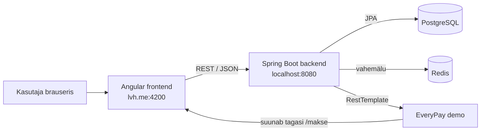
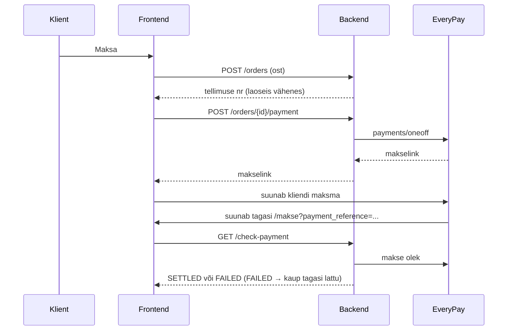
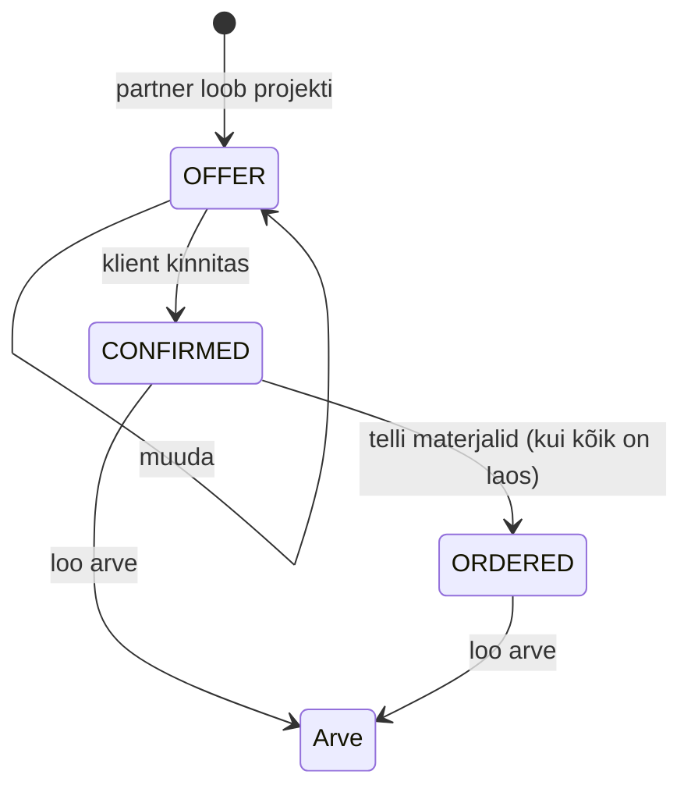

# Arhitektuur

## Kuidas osad on ühendatud

- **Frontend** ei räägi andmebaasiga otse. Kõik käib backendi REST API kaudu (JSON).
- **Backend** jaguneb kihtideks: `controller` võtab päringu vastu, `service` teeb äriloogika (hinnad, laoseis, kontrollid), `repository` räägib andmebaasiga.
- **Redis** hoiab tootenimekirja vahemälus. Kui Redis ei tööta, võetakse andmed andmebaasist.
- **EveryPay** maksega: backend loob makse ja saab makselingi, klient maksab EveryPay lehel, EveryPay suunab kliendi tagasi frontendi `/makse` lehele ja frontend küsib backendilt makse oleku.

## Makse käik

## Partneri projekti käik

Projekti saab muuta ja kustutada, kuni materjale pole tellitud ja arvet pole tehtud.

## Olemid

| Olem | Mida hoiab |
| --- | --- |
| `Category`, `Product` | Kategooria ja toode |
| `ProductVariant` | Kõrgus (mm), värv, hind koos KM-ga, kaal, laoseis, eeldatav tarnekuupäev |
| `Person`, `Address` | Klient või partner. Partneril on tase (`PartnerLevel`), ettevõtte andmed, logo, paigalduse tunnihind |
| `Order`, `OrderItem` | Päring või ost (`OrderType`), makse olek (`PaymentState`), read koos tellimuse hetke hinnaga |
| `Project`, `ProjectItem` | Partneri kliendi projekt, materjalid, paigalduse hind, olek (`ProjectStatus`) |
| `Invoice`, `InvoiceLine` | Partneri arve kliendile. Read ja summad salvestatakse arve juurde, et arve hiljem ei muutuks |

## Endpointid

| Meetod ja aadress | Mida teeb |
| --- | --- |
| `GET /products`, `GET /products/{id}` | Tooted koos variantidega (vahemälus) |
| `POST`, `PUT /products`, `DELETE /products/{id}` | Toote lisamine, muutmine, kustutamine |
| `PUT /variants/{id}/expected-date?date=` | Variandi eeldatav tarnekuupäev |
| `GET`, `POST /categories`, `DELETE /categories/{id}` | Kategooriad |
| `POST /orders` | Päring või ost. Partneri hinna arvutab backend |
| `GET /orders`, `GET /my-orders/{personId}` | Tellimused |
| `POST /orders/{id}/payment` | EveryPay makse loomine |
| `GET /check-payment?paymentReference=` | Makse olek |
| `GET /partners`, `PUT /partners/{id}/profile` | Partnerid ja partneri ettevõtte andmed |
| `GET`, `POST /partners/{id}/projects` | Partneri projektid |
| `PUT /projects/{id}` | Projekti muutmine |
| `PUT /projects/{id}/confirm` | Klient kinnitas pakkumise |
| `POST /projects/{id}/order` | Materjalide tellimine partneri hinnaga |
| `DELETE /projects/{id}` | Projekti kustutamine |
| `POST /projects/{id}/invoice` | Arve koostamine (read, allahindlus, maksetähtaeg) |
| `GET /partners/{id}/invoices`, `GET /invoices/{id}` | Arved |
| `PUT /invoices/{id}/paid` | Arve makstuks |

Täpsed päringu ja vastuse kujud on Swaggeris: `http://localhost:8080/swagger-ui/index.html`.

## Olulised reeglid

- Laoseis väheneb ainult ostu korral, mitte päringu korral.
- Kui makse ebaõnnestub, pannakse kaup üks kord lattu tagasi.
- Partneri hind = hind × (100 − allahindlus%) / 100. Hinda arvutab alati backend, frontendi hinda ei usaldata.
- Paigalduse hind = komplektide arv × tunde komplekti kohta × tunnihind, kui partner ei kirjuta hinda ise.
- Arve number on kujul `2026-001`, iga partneri arved on oma järjekorras.
- Vahemälu `products` tühjendatakse tellimuse, makse kontrolli, toote muutmise ja tarneaja muutmise järel.
